# vstack

Claude Code 플러그인. `v-mode` 라우터가 요청에 맞는 레시피를 고르고, 레시피는 원칙과 검증 계약을 지키며 일한다. mattpocock 정렬 스킬(무엇을, 왜), pstack 원칙과 검증(어떻게 제대로), 지휘(누가, 언제)를 하나로 묶는다. 지휘는 agent-orchestra(아카이브됨)에서 옮겨 와 vstack이 소유한다.

> 완성(0.20.1, 2026-11-14). 계약(`vstack-contract@4`), 원칙 24개, v-mode 라우터, 지휘 스킬, 레시피 일곱(버그 수정, 기능, 리팩토링, UI 다듬기, 조사, 반복 실수 막기, 성능 개선), 조사 에이전트가 있다. 시범 저장소에서 지휘와 맡기기를 여러 번 돌렸고, 실제 프로젝트에서 맡기기 한 번과 지휘 한 번을 끝까지 돌렸다([docs/pilot-6.md](docs/pilot-6.md)). 진행 기록과 설계는 [docs/design.md](docs/design.md), 되돌리기 어려운 결정은 [docs/adr/](docs/adr/), 용어는 [GLOSSARY.md](GLOSSARY.md)에 있다.

## 설치

vstack은 mattpocock-skills(`claude-plugins-official` 마켓플레이스)에 기댄다. 정렬 단계의 `grill-with-docs`·`to-spec`·`to-tickets`와 `wait-what`이 그 플러그인의 명령이다. vstack은 이것을 의존성으로 선언해 두었으므로, 그 마켓플레이스가 추가돼 있으면 vstack을 설치할 때 함께 설치된다. 그 마켓플레이스가 없으면 mattpocock-skills가 설치되지 않고 **vstack도 로드되지 않는다**. 먼저 `/plugin marketplace list`로 `claude-plugins-official`이 등록돼 있는지 확인하고, 없으면 아래처럼 추가한다(빈 설정 폴더에서 명령줄로만 설치했을 때는 등록돼 있지 않았다).

```
/plugin marketplace add anthropics/claude-plugins-official   # 이미 있으면 건너뛴다
/plugin marketplace add vananaHope/vstack
/plugin install vstack@vstack                                # mattpocock-skills도 함께 설치된다
```

- 순서를 바꿔 vstack을 먼저 설치했으면, 나중에 `claude-plugins-official`을 추가할 때 mattpocock-skills가 설치된다.
- mattpocock-skills는 버전을 고정하지 않았다. 그 마켓플레이스의 새 버전을 따라간다.
- vstack을 지운 뒤 의존성을 정리하려면 `claude plugin prune --dry-run`으로 대상을 먼저 본다. `claude plugin prune`은 그 범위(기본 user)에서 어느 플러그인도 더는 필요로 하지 않는 자동 설치 의존성을 지운다. 다른 플러그인이 쓰거나 직접 설치한 플러그인은 남는다.
- Windows에서 `claude-plugins-official` 추가가 `Filename too long`으로 실패하면 설정 폴더 경로가 너무 긴 것이다.

## 쓰기

`/vstack:v-mode`로 시작해 하려는 일을 말한다. v-mode가 크기와 작업 유형을 보고 갈래를 고른다.

프로젝트에서 처음 쓰기 전에 `/vstack:configure`를 한 번 실행하면 좋다. 프로젝트 설정(준비·테스트 명령, 작성 규칙, 구현 제약, 지휘의 배치·명세 점검 모델·병합)을 설정 창으로 만들고, 맡기기와 지휘가 이것을 함께 읽는다. 끝에 전제(Orca, `gh`·`claude`·`codex`, 한도, `.local/` 무시, mattpocock 설정, 검증 수단)를 점검해 알려 준다. 설정이 없어도 맡기기는 저장소를 훑어 정하고, 지휘는 처음 실행할 때 이 설정부터 띄운다.

홈 레포(다른 저장소를 가리키는 포인터를 `AGENTS.md`에 둔 저장소)에서 실행해도 된다. 그때는 다룰 저장소를 이름이나 경로로 말한다(예: "my-video-manager 이슈 진행해"). v-mode가 그 저장소를 메인 저장소로 정하고, 설정·기록·worktree를 모두 그 저장소에 둔다([skills/v-mode/main-repo.md](skills/v-mode/main-repo.md)).

<picture>
  <source media="(prefers-color-scheme: dark)" srcset="docs/images/vstack-overview-dark.svg">
  
</picture>

요청이 가는 길이다. 이 대화(관리자)는 바로 갈래 말고는 제품 코드를 쓰지 않는다. 맡기기는 계약 밖이라 증거 보관과 병합 관문이 없고, 지휘는 증거의 대상과 원격의 대상이 같을 때만 병합한다.

- 바로: 읽기 전용 질문·조사, 그리고 제품이 실행하거나 화면에 보이거나 검증이 읽는 파일을 고치지 않는 수정(문서, 주석 오타). 동작이 바뀌는 수정은 한 줄이어도, 화면 문구는 한 글자라도 맡긴다.
- 맡기기: 티켓으로 나누지 않는 한 단위의 일. 레시피(버그 수정, 기능, 리팩토링, UI 다듬기, 반복 실수 막기, 성능 개선)가 있든 없든 작업자에게 맡긴다: Claude 구현자가 새 worktree에서 구현하고, Codex 검토자가 같은 worktree에서 검토하고, 이 대화가 수용 기준을 다시 돌려 마지막에 확인한다. 검증 수단이 없으면 그것부터 따로 맡긴다. 서로 독립인 맡기기는 셋까지 함께 진행하고, 반영은 한 번에 하나다. Orca가 있어야 한다. `skills/v-mode/delegate.md`
- 지휘: 정렬(`grill-with-docs` → `to-spec` → `to-tickets`, mattpocock 플러그인 명령) → 티켓에 vstack 절 → 작업자 배정·교차 검토·증거 보관·병합 관문(Orca)

### 맡기기

<picture>
  <source media="(prefers-color-scheme: dark)" srcset="docs/images/vstack-delegate-dark.svg">
  
</picture>

### 지휘

<picture>
  <source media="(prefers-color-scheme: dark)" srcset="docs/images/vstack-orchestrate-dark.svg">
  
</picture>

## agent-orchestra를 쓰던 프로젝트에서

vstack이 agent-orchestra를 대신한다. agent-orchestra 플러그인은 지웠고 원래 저장소는 아카이브했다(2026-11-14, [ADR 0001](docs/adr/0001-move-agent-orchestra-into-vstack.md)). vstack 하나만 설치하면 된다.

- 프로젝트 설정(`docs/agents/orchestration.md` 또는 `.local/orchestration/settings.md`)과 `common-findings.md`는 그대로 읽는다.
- `.local/orchestration/`(개인용 설정 위치)과 `~/.agent-orchestra/`(실창 잠금)는 agent-orchestra 때의 이름이다. 경로는 바꾸지 않았다([ADR 0007](docs/adr/0007-keep-agent-orchestra-legacy-paths.md)). vstack의 작업 파일은 `.local/vstack/`에 따로 둔다.
- vstack 지휘가 다르게 하는 것: 레시피가 있는 작업(버그 수정, 기능, 리팩토링)만 맡는다. 레시피가 없는 일은 한 단위면 맡기기 갈래로 수용 기준만으로 맡기고, 여러 티켓이면 티켓마다 레시피가 있는 유형으로 나누거나 레시피를 먼저 만든다. 검토 목록의 `관리자` 항목은 건너뛴다. UI 다듬기는 지휘에서 하지 않고 맡기기 갈래의 `ui-polish` 레시피로 한다. 앞부분 선행 병합은 하지 않는다(`skills/orchestrate-issues/vstack.md` "첫 버전에서 하지 않는 것").
- 처음 지휘하기 전에 갖출 것: 요구 동작을 검증할 수단(없으면 v-mode가 검증 스킬 만들기부터 한다)과 티켓의 vstack 절(v-mode가 초안을 쓰고 승인을 받는다).
- agent-orchestra 때 끝나지 않은 작업(`.local/orchestration/*/state.md`)은 vstack이 이어받지 않고 사용자에게 알린다.

## 구성

```
.claude-plugin/          플러그인·마켓플레이스 정의
skills/v-mode/
  SKILL.md               라우터(고정 규칙, 갈래 고르기, 후보 원칙)
  contracts/             관리자와 작업자가 지키는 계약(vstack-contract@4)
  recipes/               레시피 형식과 레시피(bug-fix, feature, refactoring, ui-polish, investigation, correct, perf)
                         ui-polish는 맡기기 갈래에서만 쓴다. scripts/image_diff.py는 PNG 비교
  delegate*.md           한 단위의 일을 작업자에게 맡기는 절차와 명세 양식(구현, 검토)
  subagents.md           바로·맡기기 갈래에서 서브에이전트를 쓰는 규칙
agents/explorer.md       읽기 전용 조사 에이전트 vstack:explorer(Sonnet, 읽기·검색 도구만)
skills/principle-*/      pstack 원칙 24개(원문 그대로)
skills/diagnosing-bugs/, skills/tdd/, skills/create-verification-skill/
                         레시피가 경로로 읽는 스킬(고쳐 쓴 사본, UPSTREAM.md 참고)
skills/ketchup/          마지막 메시지 뒤로 바뀐 것과 사용자가 정할 것을 정리하는 스킬(pstack에서 고쳐 쓴 사본. v-mode가 경로로 읽음)
skills/benchmark-checklist/
                         성능 측정이 믿을 만한지 따지는 점검표(pstack에서 고쳐 쓴 사본. perf 레시피가 경로로 읽음)
skills/maintain-verification-skill/
                         검증 스킬과 기능 지도가 앱과 맞는지 점검하는 스킬(pstack에서 고쳐 쓴 사본. 맡기기의 구현자가 경로로 읽음)
skills/blast-radius/     변경이 다른 곳에서 깨뜨릴 것을 찾아 실행으로 증명하는 스킬
                         (pstack에서 고쳐 쓴 사본. 검토 명세와 v-mode가 경로로 읽음)
skills/orchestrate-issues/, skills/check-limits/, skills/configure/
                         지휘, 한도 확인, 프로젝트 설정 스킬(agent-orchestra에서 옮겨 와 vstack이 소유. v-mode가 경로로 읽음.
                         프로젝트 설정은 맡기기와 지휘가 함께 읽는다)
GLOSSARY.md              용어집
docs/
  design.md              설계와 변경 이력
  adr/                   되돌리기 어려운 결정 기록
  images/                README의 그림(밝은·어두운 테마 SVG 두 벌. 고칠 원본은 images/src/의 HTML)
  contract-examples/     계약 판정 예시
upstream.json            가져오는 파일 목록(정본)
UPSTREAM.md              출처, 고친 내용, 갱신 절차
licenses/                출처별 라이선스 원문
scripts/
  import.mjs             upstream.json대로 가져오기(verbatim 덮어쓰기, adapted 처음 한 번)
  collect-references.mjs 출처 참조 목록(reference-policy.md) 생성
  check-links.mjs        실행 경로의 링크 검사
```

## 검사

```
node scripts/check-links.mjs --stage <현재 단계> [--source pstack=<cursor/plugins> --source mattpocock-skills=<mattpocock-skills>]
node scripts/collect-references.mjs --source pstack=<cursor/plugins> --check
python -I -m unittest discover -s skills/v-mode/recipes/scripts -p "test_*.py"   # 이미지 비교 스크립트의 테스트
```

`check-links`가 잡는 것: 깨진 경로(`BROKEN`), vstack 파일을 표준이 아닌 인라인 경로로 가리킴(`NONSTANDARD`), vstack에 없는 스킬 이름(`SKILL`. 사용자가 직접 실행하는 다른 플러그인 명령은 `upstream.json`의 `user_commands`에 적은 것만 허용), 특정 런타임의 스킬 도구 문장(`TOOL`), `--source`를 주면 원본이 가리키던 파일의 누락(`NOT CARRIED`). 자세한 규칙은 [UPSTREAM.md](UPSTREAM.md)와 [FORMAT.md](skills/v-mode/recipes/FORMAT.md) "실행 경로 표기".

## 라이선스

MIT. [LICENSE](LICENSE). 가져온 파일의 출처와 라이선스는 [UPSTREAM.md](UPSTREAM.md)와 [licenses/](licenses/)에 있다.
