# vstack

Claude Code 플러그인. `v-mode` 라우터가 요청에 맞는 레시피를 고르고, 레시피는 원칙과 검증 계약을 지키며 일한다. mattpocock 정렬 스킬(무엇을, 왜), pstack 원칙과 검증(어떻게 제대로), 지휘(누가, 언제)를 하나로 묶는다.

> 0.30.1(2026-11-26), 계약 `vstack-contract@7`. 시범 저장소와 실제 프로젝트에서 맡기기와 지휘를 끝까지 돌렸다([pilot-6.md](docs/pilot-6.md)). 0.26.0~0.30.0에서 더한 함께 진행, 기준 브랜치, 병합 위치, Antigravity 작업자는 아직 시범으로 돌려 보지 않았다. 바뀐 내용은 [design.md](docs/design.md) "변경 이력"에 있다.

## 설치

```
/plugin marketplace add anthropics/claude-plugins-official   # 이미 있으면 건너뛴다
/plugin marketplace add vananaHope/vstack
/plugin install vstack@vstack                                # mattpocock-skills도 함께 설치된다
```

vstack은 mattpocock-skills(`claude-plugins-official` 마켓플레이스)에 기댄다. 그 마켓플레이스가 없으면 vstack도 로드되지 않는다. 맡기기와 지휘에는 [Orca](https://github.com/stablyai/orca)와 `claude`·`codex` 명령이 있어야 한다. Gemini 모델을 쓰려면 Antigravity CLI(`agy`)를 설치하고 로그인해 둔다. 없으면 Antigravity 자리는 건너뛴다. 설치에서 막히면 [문제 해결](docs/guide/troubleshooting.md)을 본다.

## 처음 쓰기

1. 다룰 저장소에서 `/vstack:configure`를 실행해 프로젝트 설정을 만든다. 끝에 전제(Orca, `gh`·`claude`·`codex`, 한도, 검증 수단 등)를 점검해 알려 준다.
2. `/vstack:v-mode`로 시작해 하려는 일을 말한다. v-mode가 크기와 작업 유형을 보고 갈래를 고르고, 첫 답에 그 근거를 적는다.

설치부터 맡기기 한 번까지의 순서는 [처음 쓰기](docs/guide/first-run.md)에 있다. 다른 저장소를 가리키는 홈 레포에서 실행해도 된다. 그때는 다룰 저장소를 이름이나 별칭으로 말한다(예: "mvm #285 지휘해").

## 세 갈래

<picture>
  <source media="(prefers-color-scheme: dark)" srcset="docs/images/vstack-overview-dark.svg">
  
</picture>

이 대화(관리자)는 바로 갈래 말고는 제품 코드를 쓰지 않는다.

- **바로**: 읽기 전용 질문·조사, 그리고 제품이 실행하거나 화면에 보이거나 검증이 읽는 파일을 고치지 않는 수정(문서, 주석 오타). 동작이 바뀌는 수정은 한 줄이어도 맡긴다.
- **맡기기**: 티켓으로 나누지 않는 한 단위의 일. 구현자(기본 Claude)가 새 worktree에서 구현하고, 다른 계열의 검토자(기본 Codex)가 같은 worktree에서 검토하고, 관리자가 수용 기준을 다시 돌려 확인한다. 계약 밖이라 증거 보관과 병합 관문이 없다. [자세히 →](docs/guide/delegate.md)
- **지휘**: 이슈 저장소의 티켓 여러 개. 정렬과 티켓, 티켓의 vstack 절, 등급별 작업자, 다른 계열의 교차 검토, 증거 보관, 병합 관문 G1~G5를 거쳐 기준 브랜치에 병합한다. [자세히 →](docs/guide/orchestrate.md)

기능마다 worktree를 따로 만들어 그 안에서 지휘하고, 마지막에 PR 하나로 기본 브랜치에 넣을 수도 있다. [기능 브랜치에서 지휘하기 →](docs/guide/feature-branch.md)

## 문서

| 읽는 사람 | 문서 |
| --- | --- |
| vstack을 쓰는 사람 | [사용 안내](docs/guide/): [처음 쓰기](docs/guide/first-run.md), [개념](docs/guide/concepts.md), [맡기기](docs/guide/delegate.md), [지휘](docs/guide/orchestrate.md), [기능 브랜치에서 지휘하기](docs/guide/feature-branch.md), [프로젝트 설정](docs/guide/settings.md), [문제 해결](docs/guide/troubleshooting.md) |
| agent-orchestra에서 넘어오는 사람 | [agent-orchestra를 쓰던 프로젝트에서](docs/guide/migrate-from-agent-orchestra.md) |
| vstack을 고치는 사람 | [CONTRIBUTING.md](CONTRIBUTING.md)(구성, 검사, 관례), [design.md](docs/design.md)(설계와 변경 이력), [docs/adr/](docs/adr/)(되돌리기 어려운 결정), [GLOSSARY.md](GLOSSARY.md)(용어) |

## 라이선스

MIT. [LICENSE](LICENSE). 가져온 파일의 출처와 라이선스는 [UPSTREAM.md](UPSTREAM.md)와 [licenses/](licenses/)에 있다.
