# 개념

vstack을 쓰면서 계속 나오는 말과 구조다. 낱말의 정의는 [GLOSSARY.md](../../GLOSSARY.md)가 정본이고, 여기서는 그 말들이 어떻게 맞물리는지 설명한다.

## 세 층

vstack은 세 출처의 스킬을 층으로 묶는다([design.md](../design.md) 2절).

| 층 | 답하는 질문 | 출처 |
| --- | --- | --- |
| 정렬 | 무엇을, 왜 만드나 | mattpocock-skills(`grill-with-docs`, `to-spec`, `to-tickets`) |
| 실행 품질 | 한 단위의 일을 어떻게 제대로 하나 | pstack 원칙과 검증, vstack 레시피 |
| 배치 | 누가, 언제, 누구의 검토를 받아 하나 | 지휘(agent-orchestra에서 옮겨 와 vstack이 소유) |

## 갈래

`/vstack:v-mode`가 요청 하나를 크기와 작업 유형으로 보고 세 갈래 가운데 하나로 보낸다. 고른 갈래와 근거는 첫 답의 갈래 줄에 나온다.

<picture>
  <source media="(prefers-color-scheme: dark)" srcset="../images/vstack-overview-dark.svg">
  
</picture>

| 갈래 | 무엇이 오나 | 누가 하나 |
| --- | --- | --- |
| 바로 | 읽기 전용 질문·조사, 제품이 실행하거나 화면에 보이거나 검증이 읽는 파일을 고치지 않는 수정(문서, 주석 오타) | 관리자 |
| 맡기기 | 티켓으로 나누지 않는 한 단위의 일. 동작이 바뀌는 수정은 한 줄이어도 여기로 온다 | 구현자(기본 Claude), 다른 계열의 검토자(기본 Codex), 관리자 확인 |
| 지휘 | 이슈 저장소의 티켓 여러 개 | 등급별 작업자, 다른 계열의 교차 검토, 병합 관문 |

자세한 흐름은 [delegate.md](delegate.md)와 [orchestrate.md](orchestrate.md)에 있다.

## 관리자와 작업자

- **관리자**는 사용자와 이야기하는 이 대화다. 일을 배정하고 결과를 판정하지만, 바로 갈래 말고는 제품 코드를 쓰지 않는다([ADR 0010](../adr/0010-manager-writes-no-product-code.md)).
- **작업자**는 Orca가 띄우고 감독하는 에이전트 세션이다. 맡은 역할에 따라 **구현자**나 **검토자**가 된다. 검토자는 구현자와 다른 계열 모델이다. 계열은 `codex`, `claude`, `antigravity`(지휘에서만, Gemini 모델) 셋이다.
- **서브에이전트**는 관리자나 구현자가 자기 안에서 띄우는 읽기 전용 조사 에이전트(`vstack:explorer`)다. 작업자가 아니다.
- 관리자는 기록(맡기기 하나, 지휘 작업 하나)마다 하나다. 다른 세션이 관리하던 기록은 사용자 확인을 받고 이어받는다([ADR 0014](../adr/0014-one-manager-per-record.md)).

## 장소

- **메인 저장소**는 맡기기와 지휘가 다루는 제품 저장소의 기본 checkout이다. 프로젝트 설정, 작업 기록(`.local/`), 작업자 worktree가 모두 여기를 기준으로 한다.
- **홈 레포**는 다른 저장소를 가리키는 포인터를 `AGENTS.md`에 둔 저장소다. 홈 레포에서 "mvm #285 지휘해"처럼 저장소 이름·별칭·경로를 말하면 그 저장소가 메인 저장소가 된다([main-repo.md](../../skills/v-mode/main-repo.md)).
- **관리자 작업 트리**는 관리자가 메인 저장소의 브랜치와 커밋되지 않은 변경을 보는 checkout이다. 보통 메인 저장소와 같고, 사용자가 다른 worktree에서 일하던 중이면 그 worktree다.
- **기준 브랜치**는 관리자 작업 트리의 지금 브랜치다. 맡기기와 지휘는 이 브랜치에서 작업 worktree를 만들고 결과를 이 브랜치로 보낸다. 기본 브랜치일 수도 있고 기능 브랜치일 수도 있다([ADR 0015](../adr/0015-base-branch-per-orchestration.md), [feature-branch.md](feature-branch.md)).
- **병합 위치**는 지휘가 이슈를 기준 브랜치에 넣는 곳이다. `원격`(기본)이면 이슈마다 PR로, `로컬`이면 관리자가 로컬로 병합한다. `로컬`은 기준 브랜치가 기본 브랜치가 아닐 때만 쓰인다([ADR 0016](../adr/0016-local-merge-orchestration.md)).

## 레시피와 원칙

- **레시피**는 한 작업 유형을 하는 방법이다. 일곱 개가 있다: `bug-fix`, `feature`, `refactoring`, `ui-polish`, `investigation`, `correct`, `perf`. 지휘는 `bug-fix`, `feature`, `refactoring`만 받는다. 형식은 [FORMAT.md](../../skills/v-mode/recipes/FORMAT.md)에 있다.
- **원칙**은 pstack에서 원문 그대로 가져온 24개다(`skills/principle-*`). v-mode가 요청마다 후보 원칙을 고른다.

## 계약과 병합 관문

- **계약**은 지휘에서 관리자와 작업자가 지키는 증거와 병합 관문의 규칙이다(`vstack-contract@7`, [contracts/](../../skills/v-mode/contracts/)). 맡기기에는 적용되지 않는다.
- **병합 관문**은 관리자가 병합하기 직전에 확인하는 다섯 조건이다: G1 수용 기준 통과, G2 버전, G3 검토 통과, G4 시도 정산, G5 역할 자격. 하나라도 어긋나면 병합하지 않는다. 관문은 관리자가 실행하는 병합에만 보장한다. 사람이 직접 병합하면 지휘는 사후에 같은 확인을 하고 어긋나면 알린다([ADR 0006](../adr/0006-merge-gate-only-for-manager-merges.md)).
- 맡기기의 관리자 확인과 Codex 검토는 계약의 교차 검토나 병합 관문을 대신하지 않는다. 결과를 계약에 올리려면 지휘로 다시 시작한다.
