# 맡기기

티켓으로 나누지 않는 한 단위의 일을 작업자에게 넘기는 갈래다. 레시피(버그 수정, 기능, 리팩토링, UI 다듬기, 반복 실수 막기, 성능 개선)가 있으면 그것을 따르고, 없으면 수용 기준만으로 맡긴다. 절차의 정본은 [skills/v-mode/delegate.md](../../skills/v-mode/delegate.md)다.

<picture>
  <source media="(prefers-color-scheme: dark)" srcset="../images/vstack-delegate-dark.svg">
  
</picture>

## 흐름

1. **맡기기 전 확인.** 관리자가 두 가지를 본다. 맡겨도 되는 일인가(틀리면 비싼 일이 아니다, 한 단위다, 수용 기준과 검증 명령을 정할 수 있다). 지금 맡길 수 있는가(Orca 안이다, 작업 유형을 정했다, 진행 중인 일과 겹치지 않는다, 기준 브랜치에 필요한 것이 다 있다). 어느 쪽이든 아니면 까닭을 알리고 멈춘다. 관리자가 대신 구현하지 않는다.
2. **구현.** Claude 구현자가 기준 브랜치에서 만든 새 worktree에서 구현하고 커밋한 뒤 완료 보고를 한다.
3. **구현 확인.** 관리자가 그 worktree에서 필수 수용 기준 명령을 모두 다시 돌린다.
4. **검토.** Codex 검토자가 같은 worktree에서 읽기 전용으로 검토한다.
5. **판정과 수정.** 관리자가 지적마다 고칠지 정하고, 고칠 것은 구현자에게 보낸다. 재검토는 두 번까지다.
6. **마지막 확인과 반영.** 통과하면 검토 결론, 지적 처분, 수용 기준 결과를 알린다. 반영 방법(PR, 기준 브랜치에 로컬 병합, 그대로 둠)은 사용자가 정한다. 반영한 뒤 기준 브랜치에서 수용 기준을 다시 돌리고 작업자를 정리한다.

## 알아 둘 것

- **계약 밖이다.** 증거 보관과 병합 관문이 없다. 결과를 계약에 올리려면 지휘로 다시 시작한다.
- **검증 수단이 없으면** 그것부터 따로 맡긴다(`create-verification-skill`). 프로젝트에 verify 스킬이 있으면 거기에 시나리오를 더한다.
- **함께 진행.** 서로 독립인 맡기기는 셋까지 함께 진행하고, 반영은 한 번에 하나다. 쓰는 곳(바꿀 파일과 모듈)과 검증 자원(포트, DB, 데이터 폴더)이 겹치면 앞의 것이 끝난 뒤에 맡긴다.
- **지휘와 함께.** 진행 중인 지휘 작업과도 쓰는 곳과 검증 자원이 겹치지 않으면 함께 진행한다. 지휘의 기준 브랜치에는 로컬 병합으로 반영하지 않는다. 그 지휘의 병합 위치가 `로컬`이면 예외다([ADR 0013](../adr/0013-delegation-alongside-orchestration.md), [ADR 0016](../adr/0016-local-merge-orchestration.md)).
- **UI 다듬기**(`ui-polish`)는 맡기기에서만 한다. 지휘 크기로 오면 화면 묶음 하나씩 맡기기로 나누라고 권한다.
- **"여기서 해"**라고 말하면 관리자가 직접 하지만, 검토가 붙지 않는다고 먼저 알린다. 관리자가 이 길을 먼저 권하지 않는다.
- 기록은 메인 저장소의 `.local/vstack-delegate/`에 남는다. 관리자가 다시 시작하면 그 기록으로 이어 간다.
