# 지휘

이슈 저장소의 티켓 여러 개를 계약과 병합 관문을 거쳐 작업자에게 넘기는 갈래다. 절차의 정본은 [skills/orchestrate-issues/SKILL.md](../../skills/orchestrate-issues/SKILL.md)이고, 계약과 이어지는 곳은 [vstack.md](../../skills/orchestrate-issues/vstack.md)에 있다.

<picture>
  <source media="(prefers-color-scheme: dark)" srcset="../images/vstack-orchestrate-dark.svg">
  
</picture>

## 시작하기 전에

- **프로젝트 설정.** 없으면 지휘가 처음 실행될 때 설정 창부터 띄운다([settings.md](settings.md)).
- **레시피가 있는 티켓만.** 지휘는 `bug-fix`, `feature`, `refactoring` 레시피가 있는 티켓만 받는다. 레시피가 없는 일은 한 단위면 맡기기로, 여러 티켓이면 레시피가 있는 유형으로 나누거나 레시피를 먼저 만든다.
- **검증 수단.** 수용 기준의 검증 명령이 쓰는 실행 기반(테스트 러너, verify 시나리오, 환경 준비)은 지휘를 시작하기 전에 기준 브랜치에 있어야 한다. 레시피가 작업 브랜치에서 만드는 테스트(회귀 테스트 등)는 미리 넣지 않는다.

## 흐름

1. **정렬·명세·티켓.** 사용자가 mattpocock 명령을 직접 실행한다: `/mattpocock-skills:grill-with-docs` → `/mattpocock-skills:to-spec` → `/mattpocock-skills:to-tickets`. 이미 있는 단계는 건너뛴다.
2. **vstack 절.** 티켓마다 레시피 ID와 버전, 수용 기준(`AC-<n>@<버전>`, 필수 여부, 검증 명령), seam, 건드리지 말 영역을 적은 "vstack" 절이 있어야 한다. 없으면 v-mode가 초안을 쓰고 승인을 받아 티켓에 더한다.
3. **배정.** 관리자가 티켓마다 등급(`light`/`standard`/`hard`/`max`)을 정하고, 배정 전 입력 검사를 거쳐 등급 목록의 작업자에게 맡긴다.
4. **구현과 증거.** 구현자가 worktree에서 구현하고 증거를 남긴다. 관리자가 증거를 보관한다.
5. **교차 검토.** 구현자와 다른 계열의 검토자가 같은 수용 기준을 새 상태에서 다시 돌린다.
6. **판정.** 지금 고칠 지적이 있으면 고친 뒤 새 검토로 돌아간다.
7. **병합 관문과 병합.** G1~G5를 모두 통과하면 기준 브랜치에 병합한다. 병합 위치가 `원격`이면 이슈마다 PR로, `로컬`이면 관리자가 로컬로 병합한다.
8. **기본 브랜치에 넣기.** 기준 브랜치가 기본 브랜치가 아니면 다룰 이슈가 모두 끝났을 때 멈추고, 사용자 지시로 기준 브랜치→기본 브랜치 PR을 연다([feature-branch.md](feature-branch.md)).

## 병합 설정

프로젝트 설정 "병합" 절에서 정한다.

- **병합 방식**: `자동`이면 교차 검토가 통과한 뒤 관리자가 PR과 병합까지 한다. `지시`면 "지시 대기"로 두고 사용자가 "병합해"라고 할 때만 한다.
- **병합 방법**: `merge`/`squash`/`rebase`. 병합 위치가 `로컬`이면 `rebase`는 쓸 수 없다.
- **병합 위치**: `원격`(기본) 또는 `로컬`. [concepts.md](concepts.md) "장소".

## 알아 둘 것

- 작업 파일과 상태는 메인 저장소의 `.local/vstack/<작업 이름>/`에 있다. `state.md` 첫 줄이 지금 상태다.
- 검토에서 되풀이해 나온 지적은 `common-findings.md`에 모인다. 구현자와 검토자가 이 목록을 먼저 본다.
- 앞부분 선행 병합과 지휘 안의 UI 다듬기는 하지 않는다([vstack.md](../../skills/orchestrate-issues/vstack.md) "첫 버전에서 하지 않는 것").
- 한도는 지휘가 [check-limits](../../skills/check-limits/SKILL.md)로 재고, 한도가 넉넉하지 않은 에이전트는 건너뛴다. Antigravity는 `agy -p /usage`의 보고로 잰다.
- 작업자 계열은 `codex`, `claude`, `antigravity`(Antigravity CLI로 Gemini 모델) 셋이다. 기본 배치에서 Antigravity는 구현 목록의 Claude 앞, 검토 목록의 Codex 뒤에 있고, `agy`가 없는 컴퓨터에서는 건너뛴다([tiers.md](../../skills/orchestrate-issues/tiers.md)).
